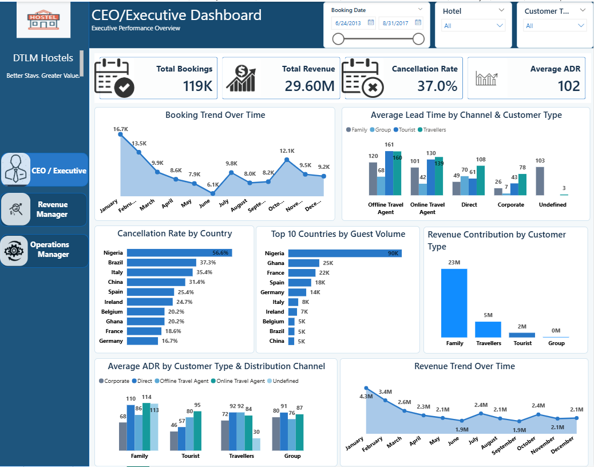
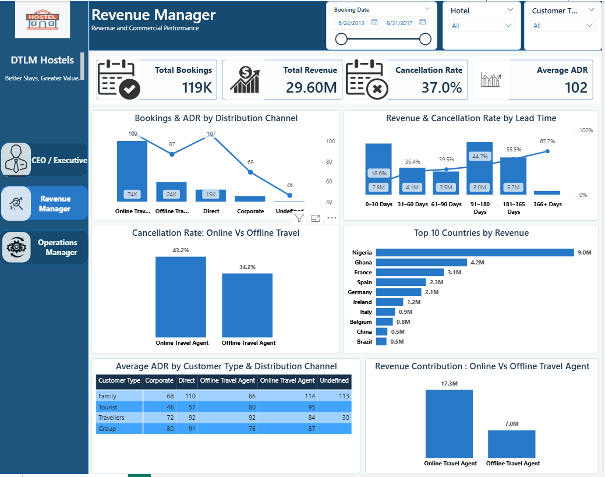
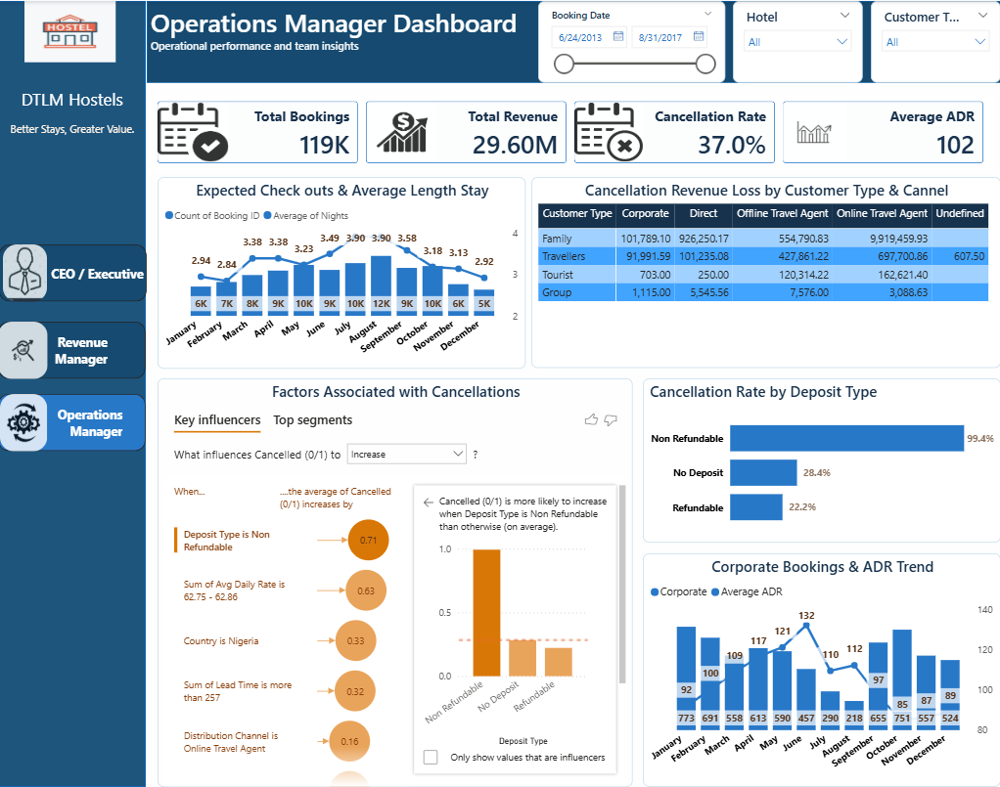

# 🏨 DTLM Hostels: Hotel Booking Analysis (Power BI)

An interactive three-page Power BI dashboard analysing **119K bookings and 29.60M in revenue** for DTLM Hostels (Dataleum Hotel Group), covering booking patterns, cancellations, revenue drivers and operations.

**Tools:** Power BI · DAX · Power Query
**Author:** Cornelius Fiyinfoluwa · [GitHub](https://github.com/corneliusdamilola64-cell)

---

## 📌 Business Problem

Based on a project brief from Dataleum Hotel Group (DHG): examine historical booking data from one of its resorts to find trends, understand customer behaviour and recommend actions. Leadership needed answers on:

- When do bookings and revenue peak, and what drives them?
- Why are so many bookings cancelled, and what does it cost?
- Which channels, countries and customer types matter most?
- How can operations (stay length, check-outs, deposits) be planned better?

## ✨ Key Features

- **Three role-based dashboards** (CEO, Revenue Manager, Operations Manager) with a clickable navigation panel
- **Interactive filtering** by booking date, hotel and customer type, with every chart updating together
- **Cancellation analysis** using Power BI's Key Influencers visual, plus lead-time, channel, country and deposit breakdowns

## 📊 Headline KPIs

| Total Bookings | Total Revenue | Cancellation Rate | Average ADR |
|:---:|:---:|:---:|:---:|
| **119K** | **29.60M** | **37.0%** | **102** |

Booking date range in the report: 24 Jun 2013 to 31 Aug 2017.

## 🖥️ Dashboard Pages

The report has three role-based pages, all with slicers for **Booking Date, Hotel and Customer Type**.

### 1. CEO / Executive: performance overview


Booking trend, revenue trend, cancellation rate by country, top 10 countries by guest volume, revenue by customer type, lead time and ADR by channel.

### 2. Revenue Manager: revenue and commercial performance


Bookings and ADR by distribution channel, revenue and cancellation rate by lead time, online vs offline travel agents, top 10 countries by revenue, ADR matrix by customer type and channel.

### 3. Operations Manager: operational performance


Expected check-outs and average length of stay, cancellation revenue loss by customer type and channel, key influencers of cancellation, cancellation by deposit type, corporate bookings and ADR trend.

## 🔍 Key Insights

**Booking patterns**
- Bookings peak in **January (16.7K)**, fall to a low in **June (6.1K)**, then have a second peak in **October (12.1K)**. Revenue follows the same shape, from about 4.3M in January to lows near 1.9M mid-year.
- Average length of stay ranges from roughly **2.8 to 3.9 nights** across the year.

**Channels**
- **Online travel agents** bring the most bookings (74K) and the most revenue (**17.3M vs 7.0M** for offline agents), but also cancel more: **43.2% vs 34.2%**.

**Cancellations**
- Cancellation risk rises steadily with lead time: **18.6%** for 0–30 days up to **67.7%** for bookings made 366+ days ahead.
- **Nigeria** is the largest source market (about 90K guests, 9.0M revenue) and also has the highest cancellation rate (**56.6%**). Ghana, the second largest market, is at 20.2%.
- The largest revenue loss from cancellations is **Family bookings via online travel agents (about 9.9M)**.
- Deposit type is the top cancellation influencer in the key-influencers visual. Non-refundable bookings show a **99.4%** cancellation rate, against 28.4% for no deposit and 22.2% for refundable. The raw data confirms this (14,587 non-refundable bookings, almost all cancelled), so it is a real pattern in the data rather than a modelling error, but it is unusual and worth checking with the business.

**Revenue**
- **Family** is the dominant customer type (about 23M of 29.6M). Travellers contribute about 5M and Tourists about 2M.

## 💡 Recommendations

1. **Tighten long-lead bookings**: introduce deposits or flexible reconfirmation for bookings made 90+ days ahead, where cancellation rates exceed 44%.
2. **Manage online travel agent risk**: negotiate stricter cancellation terms or overbooking buffers with online agents, given their high volume and 43.2% cancellation.
3. **Target Nigeria's cancellations**: investigate why the biggest market cancels most (payment friction, booking behaviour, channel mix) before scaling marketing there.
4. **Protect the Family segment**: it carries most revenue and most cancellation loss, so it is the best place for retention and pricing work.
5. **Plan for seasonality**: run promotions in the June trough and staff and stock for the January and October peaks.
6. **Review non-refundable deposits**: they cover about 12% of bookings and almost all cancel, so check whether the deposit label is being applied correctly at booking.

## 🗂️ Data

Booking-level data with one row per booking: **119,390 rows, 17 fields**, two hotel types (City 79,330 and Resort 40,060) and 172 countries.

| Field | Description |
|---|---|
| Booking ID | Unique booking identifier |
| Hotel | Hotel within the group |
| Booking Date / Arrival Date | When the booking was made / guests arrive |
| Lead Time | Days between booking and arrival |
| Nights, Guests | Length of stay, party size |
| Distribution Channel | Direct, Online Travel Agent, Offline Travel Agent, Corporate, Undefined |
| Customer Type | Family, Travellers, Tourist, Group |
| Country | Guest country of origin |
| Deposit Type | No Deposit, Refundable, Non Refundable |
| Avg Daily Rate (ADR) | Average daily rate for the booking |
| Status / Status Update | Booking status and date of last update |
| Cancelled (0/1) | 1 if cancelled (includes no-shows) |
| Revenue / Revenue Loss | Revenue earned / revenue lost to cancellation (stored as a negative value) |

## 🛠️ Method

1. **Data profiling.** The source is a single Excel table of **119,390 bookings × 17 columns** (Jul 2015 to Aug 2017 arrivals; bookings made from Jun 2013). Checks run before modelling:
   - No duplicate rows and no duplicate Booking IDs.
   - Lead Time equals Arrival Date minus Booking Date on every row, and no booking arrives before it was made.
   - Status and the cancelled flag agree (all 43,017 Canceled and 1,207 No-Show rows are flagged 1, all Check-Out rows are 0).
   - Only **Country** has blanks (488 rows).
2. **Cleaning and preparation (Power Query).** Set data types (dates, whole numbers, decimals), and kept the 0/1 cancellation flag numeric so it can be averaged. Data-quality issues worth handling or documenting:
   - 488 blank countries.
   - 5 bookings with an "Undefined" distribution channel.
   - 715 bookings with 0 nights, 180 with 0 guests, and 1,960 with an ADR of 0 or less (one negative). All rows are kept in the model; the single booking with a negative ADR (and therefore negative revenue) is excluded only through visual-level filters on the ADR and revenue charts.
   - Outliers: one ADR of 5,400, stays of 60+ nights and bookings of up to 55 guests. They were reviewed and kept: together they change the headline KPIs by less than 0.1% (average ADR 101.79 without the 5,400 booking vs 101.83 with it), so no insight or recommendation is affected.
   - Revenue Loss is stored as a **negative** number for cancelled bookings and 0 otherwise, so the dashboard shows it as a positive loss. These negative values are the normal way losses are stored and are **not** filtered out.
3. **Calculated columns.**
   - **Lead-time bands:** 0–30, 31–60, 61–90, 91–180, 181–365 and 366+ days.
   - **Month name and month number** from Booking Date, so months sort in calendar order.
4. **Measures (DAX).** Each of these reproduces the dashboard figures exactly when run on the data:
   - Total Bookings = count of Booking ID → **119,390**
   - Total Revenue = sum of Revenue → **29,600,597**
   - Cancellation Rate = average of Cancelled (0/1) → **37.04%**
   - Average ADR = average of Avg Daily Rate → **101.8**
   - Guest Volume = sum of Guests (Nigeria 90,106)
   - Revenue Loss = sum of Revenue Loss, sign reversed
   - Average length of stay = average of Nights
5. **Date logic.** The booking and revenue trend charts group by **Booking Date** month. Expected check-outs and stay length are grouped on the operations page by the stay date fields.
6. **Dashboard design.** Three role-based pages (CEO, Revenue Manager, Operations Manager) with a shared header, a navigation panel, KPI cards and slicers for Booking Date, Hotel and Customer Type.
7. **Analysis.** Trend lines for bookings and revenue; segment comparisons by channel, customer type and country; cancellation drivers using Power BI's **Key Influencers** visual.
8. **Insights and recommendations.** Interpreted the visuals against the brief's objectives (below).

### Coverage of the brief's objectives

| Objective | Where answered |
|---|---|
| Booking patterns and seasonality | CEO page: booking and revenue trend |
| Lead time by channel and customer type | CEO page: lead time chart |
| Channel contribution and ADR | CEO and Revenue pages |
| Country distribution and revenue | CEO and Revenue pages |
| Cancellation drivers | Operations page: key influencers |
| Revenue loss by segment and channel | Operations page: loss matrix |
| Pricing and ADR | Revenue page: ADR matrix |
| Length of stay and check-outs | Operations page |
| Deposit impact | Operations page |
| Corporate bookings | Operations page: corporate trend |
| Lead time vs cancellation | Revenue page |
| Online vs offline agents | Revenue page |

## 📁 Repository Structure

```
dtlm-hotel-booking-powerbi/
├── README.md
├── images/          # dashboard screenshots
├── data/            # dataset (add file here)
└── DHG_dashboard.pbix   # Power BI report (add file here)
```

## ⚙️ Installation

1. Install [Power BI Desktop](https://powerbi.microsoft.com/desktop/) (free, Windows only).
2. Clone or download this repository:
   ```bash
   git clone https://github.com/corneliusdamilola64-cell/dtlm-hotel-booking-powerbi.git
   ```
3. Open `DHG_dashboard.pbix` in Power BI Desktop.
4. If Power BI asks for the data source, click **Transform data → Data source settings → Change Source** and point it to `data/DTLM_Hotel_Booking_Data.xlsx`.

## 📖 Usage

- Switch pages with the **CEO / Executive**, **Revenue Manager** and **Operations Manager** buttons on the left.
- Use the **Booking Date**, **Hotel** and **Customer Type** slicers at the top to filter every chart on the page.
- Click a bar or point in any chart to cross-filter the other visuals; click it again to clear.
- On the Operations page, open the **Key influencers** tab to see what drives cancellations.

## 👤 About Me

Data analyst with an industrial chemistry background and three years of teaching experience, working with Excel, SQL and Power BI.

- GitHub: [@corneliusdamilola64-cell](https://github.com/corneliusdamilola64-cell)
